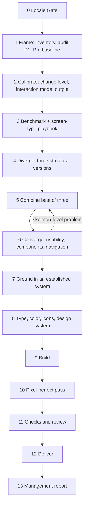

# Pipeline

## Authority
The skeleton (organization, grouping, navigation model, component set) is free in steps 4 and 5 and fixed from step 6, except that step 6.8 may swap individual components inside it.

Precedence when rules collide: (1) the user's brief and pinned constraints, (2) the Commitment and honesty (A4), (3) accessibility and ergonomic floors, (4) the later step over the earlier one, (5) the quieter, clearer, more exact option.

## Traceability
Every audit problem gets a number (P1..Pn) in step 1. Every decision in step 13 points to a P-number, or is labeled an identity or brand choice. This is what makes the final report defensible.
